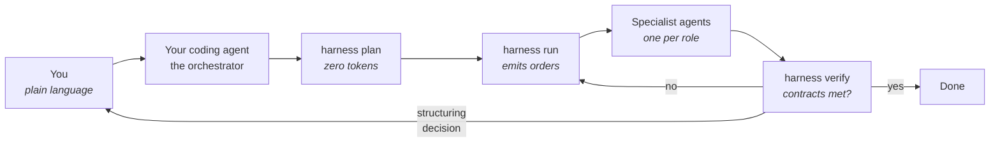

# harness

**Put several specialised agents to work autonomously on your project, without losing control.**

You describe roles. `harness` works out who should run, how, and with
which model — then checks that the work delivered keeps its promises.

Run by the orchestrator — not by you:
```
harness plan     →  who runs how, and why          (zero tokens spent)
harness run      →  the orders, ready to launch
harness verify   →  does the delivered work hold up?
```

---

## The problem

Running several agents on a project at once sounds simple. Three things always
break:

| | |
|---|---|
| **You can't tell when they're done** | You end up reading their screens to guess whether they're working or waiting |
| **A report proves nothing** | An agent announces work as finished; the file doesn't exist |
| **It costs too much** | Every agent runs on the most powerful model, even to re-read a file |

`harness` answers all three: a machine-checkable output contract, per-role model
routing, and state derived from the files themselves.

---

## How it works



**The key point**: `harness run` launches nothing itself. It produces orders —
full prompt, model, allowed tools, contract to meet — and **your own agent
session**, the one that already knows your project, executes them.

Your session already holds the project's context, completion signalling and
model routing come free with its sub-agent mechanism, and no API key is needed.

### Who types what

**You do not type `harness` commands.** Your coding agent does — the installer
teaches it both halves, writing roles and running the loop.

| | You | Your coding agent (the orchestrator) |
|---|---|---|
| Describe the roles you want | ✅ in plain language | writes the role files |
| Start the work | ✅ "go ahead" | `plan`, `run`, dispatches the agents |
| While it runs | watch it happen | `verify`, re-dispatches what failed |
| Structuring decisions | ✅ you rule | brings you the choice and its cost |
| Reading the results | ✅ | reports what passed, what didn't |

Commands appear below so you can follow along, not because you type them. If
your agent ever says *"now run `harness verify`"*, it has skipped reading its own
instructions — tell it so.

---

## Requirements

- **Node.js 18+** — no npm dependency is ever installed, the code is self-contained
- **A coding agent** able to spawn sub-agents — Claude Code, Cursor, Copilot,
  Windsurf, Codex and anything reading `AGENTS.md` are all hooked up automatically
- **tmux** — optional, only for roles that need supervision

---

## Install

```bash
git clone https://github.com/mdabo/harness.git ~/harness
cd ~/my-project
bash ~/harness/install.sh
```

> **Install from a separate terminal, then restart your coding session.** Agents
> pick up skills when they start, so a session that was already open won't know
> what a role is.

Every step is printed, and **nothing already present is reinstalled**:

```
▸ Structure du dispositif
      .harness/              + créé (roles/ skills/ artifacts/ journal.jsonl)

▸ Skills du framework
      harness-orchestrate    + posé dans .harness/skills/
      harness-roles          + posé dans .harness/skills/
      lanceur                + .harness/bin/harness → ~/harness

▸ Agents de codage détectés
      Claude Code            + .claude/skills/ → lié : harness-orchestrate harness-roles
      Cursor                 + .cursor/rules/harness.mdc

▸ Skills tiers — portée projet
      claude-mastery         + installé
      archify                · déjà présent (global) — ignoré

▸ Terminé
  5 élément(s) ajouté(s) — notés dans .harness/.installed.json
```

Three things happened there.

**Your project got a launcher**, `.harness/bin/harness`, with the framework's
path baked in. That is the command your agent uses. Nothing goes on your `PATH`.

**Your coding agent learned two skills** — writing roles, and running the loop.
They live once in `.harness/skills/`, and each agent gets a short adapter
pointing at them, in its own native format:

| Agent | Adapter | Loaded |
|---|---|---|
| Claude Code | `.claude/skills/` (symlinks) | on demand |
| Cursor · Windsurf | `.cursor/rules/harness.mdc` · `.windsurf/rules/harness.md` | on demand |
| Copilot · Codex · Zed · Aider | block in `.github/copilot-instructions.md` or `AGENTS.md` | always |

Only agents already configured in your project get one; `AGENTS.md` is enriched
if it exists, never created behind your back. Force one with
`--agents=cursor,copilot,windsurf,agents-md`. Blocks in shared files are fenced
by `<!-- harness:begin -->`, so reinstalling replaces rather than stacks.

**Third-party skills went into your project**, never your global setup, and only
if absent. Everything added is listed in `.harness/.installed.json` — remove
`harness` by deleting `.harness/` and those adapters, and nothing else is touched.

> The CLI speaks French for now; commands, formats and skills are English. See
> *Known gaps*.

---

## A real example

Take a product that has been in production for eighteen months: a multi-tenant
B2B platform, forty thousand lines, two developers who inherited most of it.
It works. Customers pay. And nobody can honestly answer three questions:

- can tenant A ever see something belonging to tenant B?
- what happens when the payment provider times out *after* charging the card?
- which of our migrations will lock a table on a Monday morning?

Those are not questions a coding session answers while you watch. Each one means
reading the whole codebase along a different axis, and none of them is the axis
you were on. That is what the extra roles are for: **not more hands on the
current task — different specialists on perimeters nobody owns.**

### Step 1 — Brief them, in your own words

You do not learn a file format, and you do not write YAML. You talk to your
coding agent the way you would brief three new joiners:

> We're going to put three people on the parts of this codebase nobody has time
> to look at.
>
> The first one only cares about tenant isolation. Every read path that touches
> customer data: where does the tenant id actually come from? I want to know if
> we ever trust one that came in on the request instead of the session, and I
> want to know whether a wrong id gives a 404 or a 403 — because if it's a 403
> we're leaking the existence of other tenants' records.
>
> The second one takes the payment and order flow, and only the failure paths.
> Provider times out after the charge went through, webhook arrives twice, user
> double-clicks submit. For each one: do we end up charging twice, do we end up
> with an order in a state nothing can move it out of?
>
> The third one reads the migrations against the models. I want the ones that
> take a lock on a big table, the foreign keys with no index behind them, and
> the backfills that run in a single transaction. We deploy at 9am and I'd like
> to stop finding out this way.

**It pushes back before writing anything.** A role built on a misread need
produces a perfectly verified artifact that answers the wrong question — the one
mistake no contract catches. So it closes the gaps first, **one question at a
time, each with its own recommendation**:

> The admin console bypasses tenant scoping by design, so every finding there
> would be a false positive. I'd leave it out of the isolation role's perimeter.
> Include it anyway?

You answer and it moves on, stopping as soon as the next question wouldn't change
the file — often one question, rarely more than three. If your brief was already
precise it skips the pass, but still states its reading in one line so a wrong
one gets caught. It never asks you to pick a model, a budget or an execution
mode: those are its job.

Then it writes the role files and shows you the plan.

### Step 2 — The plan, before anything is spent

```
Revue d'un produit en production — angles morts
4 rôle(s) — aucune exécution, aucun token consommé

Vague 1 — 3 rôle(s) en parallèle
  subagent failure-paths         règle 6 — défaut — le mode économe gagne quand rien ne s'y oppose
                                 modèle maximal · produit .harness/artifacts/failure-paths.md
  subagent migration-safety      règle 6 — défaut — le mode économe gagne quand rien ne s'y oppose
                                 modèle standard · produit .harness/artifacts/migration-safety.md
  subagent tenant-isolation      règle 6 — défaut — le mode économe gagne quand rien ne s'y oppose
                                 modèle maximal · produit .harness/artifacts/tenant-isolation.md

Vague 2 — 1 rôle(s) en parallèle
  subagent contre-expertise      auto  règle 6 — défaut — le mode économe gagne quand rien ne s'y oppose
                                 modèle maximal · produit .harness/artifacts/contre-expertise.md

auto = posé par harness, sans fichier. La contre-expertise relit les
       autres rôles et prend position sur chacun.

Bilan
  4 sous-agent(s) — signal de fin natif, routage de modèle possible
  0 session(s)     — observables, mais pas de routage de modèle
```

Three things to read here.

**Three roles run at once**, because none depends on another — they read the
same codebase along different axes and never write to the same file.

**The models differ.** Migration safety is pattern-matching against a known list
of dangerous operations; the cheap model does it as well as the expensive one.
Tenant isolation is reasoning about where a value came from across call chains —
that is where the expensive model earns its price. Getting this one distinction
right is most of what the tool saves you.

**A fourth role appeared that you never asked for.** That is the point of the
next section.

### Step 3 — The contradictor you didn't ask for

`harness` adds a **contre-expertise** role on its own, depending on every role
that produces something. You can turn it off — `contre_expertise: false` — but
you have to mean it.

The reason is that three specialists who never read each other produce three
reports that agree by omission. Each stayed inside its perimeter, so none of
them noticed that the migration adding `tenant_id` is exactly the one the
isolation role assumed was already deployed.

Its contract is built to make silence impossible without rewarding invention:

```
· frontmatter YAML avec : role, date
· au moins 1 occurrence(s) du motif : ^## (Objection|Rien à redire) — failure-paths
· au moins 1 occurrence(s) du motif : ^## (Objection|Rien à redire) — migration-safety
· au moins 1 occurrence(s) du motif : ^## (Objection|Rien à redire) — tenant-isolation
```

**One position per role reviewed, no way round it.** Demanding "at least three
objections" would have manufactured a third; demanding a verdict on each role
means "nothing to fault, and here is what I checked" stays a legitimate answer.
It finishes with a section addressed to the orchestrator: what a human has to
decide, and what can just be fixed.

### Step 4 — Let it run

You say go. From there your agent runs the loop: dispatches the three orders in
parallel on the stated models, runs `harness verify`, re-dispatches whatever
missed its contract, then releases the second wave.

```
✗ failure-paths
    .harness/artifacts/failure-paths.md
      ✗ min_bytes        206 / 1000 attendus
      ✓ frontmatter      role, date
      ✓ matches /^## Scénario/          5 trouvé(s) / 5 attendu(s)
✓ migration-safety
      ✓ min_bytes        2104 / 800 attendus
      ✓ matches /^## Migration/         7 trouvé(s) / 3 attendu(s)
✓ tenant-isolation
      ✓ min_bytes        1592 / 1200 attendus
      ✓ matches /^## Chemin/            4 trouvé(s) / 4 attendu(s)

2/4 contrat(s) satisfait(s)
```

Read the first block, because it is the whole reason the tool exists.
`failure-paths` **found its five scenarios and wrote two hundred bytes about
them.** It would have reported success. Every agent reports success. The
contract is what noticed.

Your agent re-dispatches it with that exact failure attached, and only bothers
you if it fails a second time — at which point the honest answer is often that
the contract was wrong, not the agent.

**An agent may also stop and ask** rather than invent a premise. It writes to
`.harness/questions/<role>.md`, and `run` and `verify` list what is waiting
before anything else:

```
2 question(s) en attente de réponse
  bloquant  tenant-isolation       .harness/questions/tenant-isolation.md
  avis      migration-safety       .harness/questions/migration-safety.md
```

`bloquant` — it stopped and is waiting: *"the admin console bypasses tenant
scoping; deliberate? I can't tell from the code."* It has not failed, and
`verify` marks it `⏸` rather than `✗` so nobody re-dispatches an agent that is
waiting. `avis` — it did the work but disagrees with how it was asked: *"you
asked me to judge screens from screenshots; the error states aren't in them, so
this is partial."* Worth reading before its artifact.

Your agent answers what it can find in the project and **brings you the rest**
rather than guessing — a plausible guess passes the contract, and nobody
discovers the wrong premise until someone reads the report.

### What you actually did

You described three perimeters in plain language, said go, and ruled on the
questions the contre-expertise put in front of you. You did not type a command,
write YAML, choose a model, or check whether anyone had finished.

## What a role looks like

You won't normally write this by hand — your agent does. It is here so you can
read what it produced and argue with it.

```yaml
role: tenant-isolation                  # identifier, unique
name: "Tenant isolation"                # human label

mission: >
  Find every read path where the tenant id could come from the request rather
  than the session, and every place a wrong id reveals that a record exists.

scope:
  reads:  ["src/**", "db/migrations/**"]        # read wide
  writes: ["{{artifacts}}/tenant-isolation.md"] # write narrow: one artifact

outputs:
  - id: rapport
    path: "{{artifacts}}/tenant-isolation.md"
    must:                               # machine-checked, free, no model involved
      min_bytes: 1200
      frontmatter: [role, date]
      matches:
        - pattern: "^## Chemin"
          min_count: 4                  # four paths traced, or the contract fails

execution:
  model: maximal                        # minimal | standard | maximal
  budget: { max_turns: 15 }

brief: |
  For each path: where the tenant id enters, every hop it takes, and what the
  API returns for an id belonging to someone else. A 403 where a 404 belongs is
  a finding. Name the file and the line. Don't propose a rewrite.
```

Four things are worth noticing, because they are where roles usually go wrong.

**`reads` is wide, `writes` is a single file.** A role that can write anywhere
becomes a session (rule 3), loses model routing, and needs watching. Narrow
writes are what keep it cheap.

**`must` is mechanical.** No model evaluates it, so it costs nothing and it runs
every time. Conditions written in prose need a model to judge them, so they cost
money, so they get skipped, so they become decoration.

**`min_count: 4` can fail.** A contract that any output satisfies proves nothing.
If you cannot imagine your role failing its own contract, the contract is wrong.

**The model is a deliberate choice**, not a default. This role reasons about
where a value came from across call chains — `maximal`. A role matching
migrations against a list of dangerous operations — `standard`, and it will be
just as good.

### Overriding the automatic contradictor

You don't write a contradictor: `harness` adds one. But if you want it to work
differently — read the code as well as the artifacts, or answer a specific
question — write a role with `contradicts: true` and yours replaces it:

```yaml
role: contre-expertise
contradicts: true                       # replaces the automatic one
mission: Contredire les autres rôles, et vérifier leurs constats dans le code.

scope:
  reads:  ["{{artifacts}}/**", "src/**"]
  writes: ["{{artifacts}}/contre-expertise.md"]

outputs:
  - id: objections
    path: "{{artifacts}}/contre-expertise.md"
    must:
      matches:
        - pattern: "^## (Objection|Rien à redire) — "
          min_count: 3
```

To drop it entirely, `contre_expertise: false` in `.harness/dispositif.yaml`.
That is a deliberate act, which is the intent: a setup where nobody contradicts
anybody produces reports that agree by omission.

---

## Commands

Run by your agent, not by you — listed so you can follow along, and because
`plan` is worth running yourself to price a setup before saying go. Prefix each
with `.harness/bin/harness`.

| Command | What it does |
|---|---|
| `harness plan` | Who runs how, and why. Executes nothing. |
| `harness run` | Emits orders for the next wave. `--json` · `--all` |
| `harness verify` | Evaluates contracts against existing artifacts. Non-zero exit if one fails. |
| `harness layout` | Lays out the terminal for session roles. `--apply` · `--session <name>` |
| `harness roles` | Lists roles and their scopes. |

---

## Three concepts worth knowing

### 1. The output contract

An agent does not declare itself finished: **its artifact passes tests, or it
doesn't**.

```yaml
must:                     # mechanical — free, unambiguous, always evaluated
  min_bytes: 1000
  matches: [{ pattern: "^## Finding", min_count: 5 }]

review:                   # semantic — optional, cheapest model only
  model: minimal
  asks: "Does each finding name a file? PASS or FAIL."
```

Why the split: `must` is mechanical, so it is free and runs every time. A
condition in prose needs a model to judge it — `verify` prints the question and
your agent runs it on the cheap model named there, once the mechanical checks
pass. A `FAIL` is treated like a failed contract.

### 2. Sub-agent or session

| | Sub-agent | Session |
|---|---|---|
| Completion | **Signalled natively** | Via the journal |
| Model choice | **Per role** — a ×5 to ×20 lever | The session's |
| Watching it work | Not possible | Fully |
| Correcting mid-flight | Not possible | Possible |

`harness` decides on its own, through six ordered rules visible in `plan`. **The
default is sub-agent**: it is the cheaper mode, so it should be what you get
without asking. Override with `execution.mode: session` and justify it in
`execution.reason`.

### 3. State comes from files

No registry is kept. A role is "to do" if its contract is unmet and its
dependencies are met. **Running ten times will never redo what is already
done**, and there is nothing to fall out of sync.

---

## Terminal layout

Most roles are sub-agents: they return their result and vanish, taking no screen
space. A role becomes a **session** when it writes broadly — say a fourth role
whose job is to *fix* the missing indexes rather than list them:

```yaml
role: index-repair
scope:
  writes: ["db/migrations/**"]          # rule 3 → session
```

Writing across a glob means you want to see it happen and be able to stop it.
That is the trade `harness` makes for you: it costs the model routing, and buys
you a pane you can interrupt.

```bash
.harness/bin/harness layout           # preview
.harness/bin/harness layout --apply   # creates the tmux session
```

| Session roles | Layout |
|---|---|
| 1 to 3 | One window, orchestrator on top, roles below |
| 4 to 8 | One pilot window, then one per wave |
| 9 or more | Same, waves split at 4 panes |

```
  [harness:0] pilote  ·  orchestrateur
  [harness:1] vague1
     ┌──────────┬──────────┬──────────┐
     │ tenant-  │ failure- │ index-   │
     │ isolation│ paths    │ repair   │
     └──────────┴──────────┴──────────┘
```

The pane map is written to `.harness/panes.json` using **tmux `%N` identifiers**,
which survive window reorganisation — unlike indexes and names.

---

## Controlling cost

| Lever | Effect |
|---|---|
| Per-role model routing | **×5 to ×20** — checking doesn't need the most expensive model |
| Declared `context.files` | ×2 to ×5 — no role receives the whole repository |
| Sub-agent by default | ×2 to ×4 — the search context dies with the agent |
| `context.from_roles` | Artifacts travel between roles, never conversations |

> **Rule**: a role that needs to read everything is a role that was defined too
> broadly.

---

## What harness does not do

Said before you find out:

- **No conditions, no loops** in roles. `depends_on` expresses order, not logic.
  A setup that needs an `if` is a program — write a program.
- **No direct calls between roles.** One produces, another consumes. The artifact
  is the only link.
- **No autonomous execution.** `run` produces orders; your agent launches them.
  A server-side engine, with no human present, is still to be written.
- **No arbitration.** Roles disagree, the contradictor names it, and a human
  decides. Nothing here rules on a disagreement for you.
- **Below three roles**, the tool costs more than it returns.

### Known gaps

- The CLI prints its messages in French. Command names, file formats and skills
  are in English. Translating the messages is planned.
- `arbitrate` — turning objections into a traced decision with its cost — is
  specified but not built. Contradiction itself is; arbitration is still yours.
- `uninstall` — the manifest exists, the command reading it does not. Removal is
  three deletions by hand in the meantime.
- Adapters are written from **detected** configuration. An agent that keeps its
  configuration somewhere unusual needs `--agents`, or a hand-written pointer.

---

## What an equipped project looks like

```
my-project/
├── .harness/
│   ├── dispositif.yaml      active roles and the global budget
│   ├── roles/               one file per role
│   ├── artifacts/           what roles produce
│   ├── questions/           what agents stopped to ask
│   ├── skills/              the two skills, in one neutral copy
│   ├── bin/harness          launcher, framework path baked in
│   ├── journal.jsonl        every event, append-only
│   └── panes.json           tmux map, if layout was applied
├── .claude/skills/          adapters — symlinks to .harness/skills/
└── …                        your project, untouched
```

Version `.harness/roles/` — they are team assets. `artifacts/`, `questions/`,
`journal.jsonl` and `panes.json` are run output; most projects gitignore them.

To remove `harness`: delete `.harness/`, plus the adapters listed in
`.harness/.installed.json`. Nothing else was touched.

---

## Licence

MIT — see [LICENSE](LICENSE).

The design rationale, including what each decision costs and what was
deliberately left out, is in [CAHIER-DES-CHARGES.md](CAHIER-DES-CHARGES.md)
(French).
